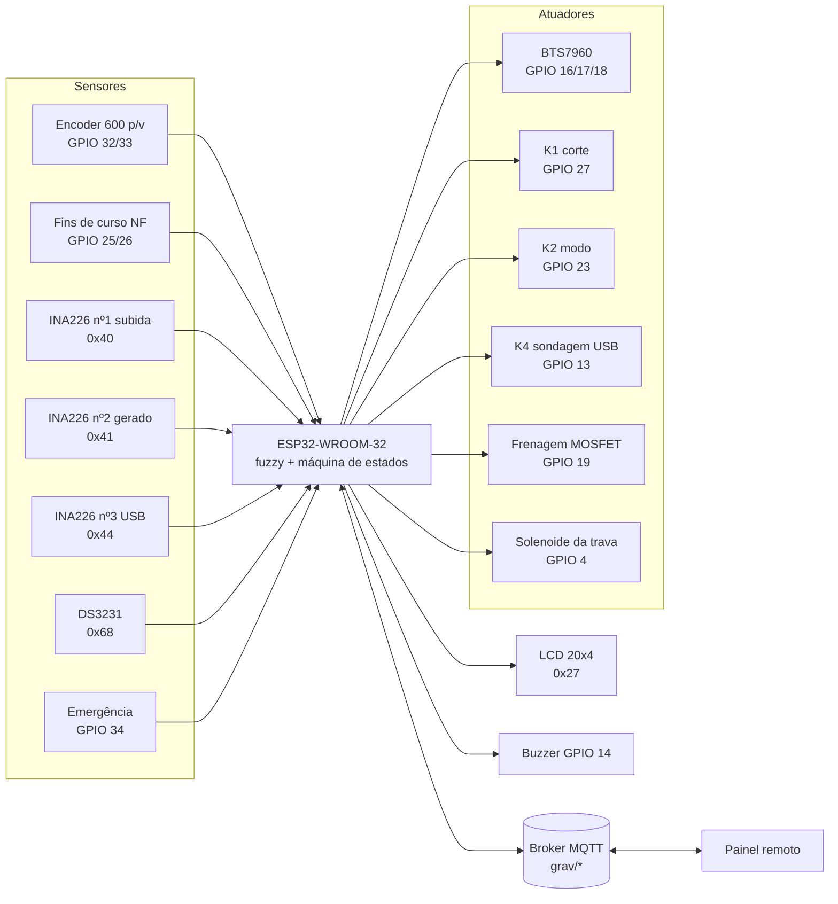
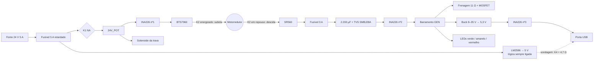
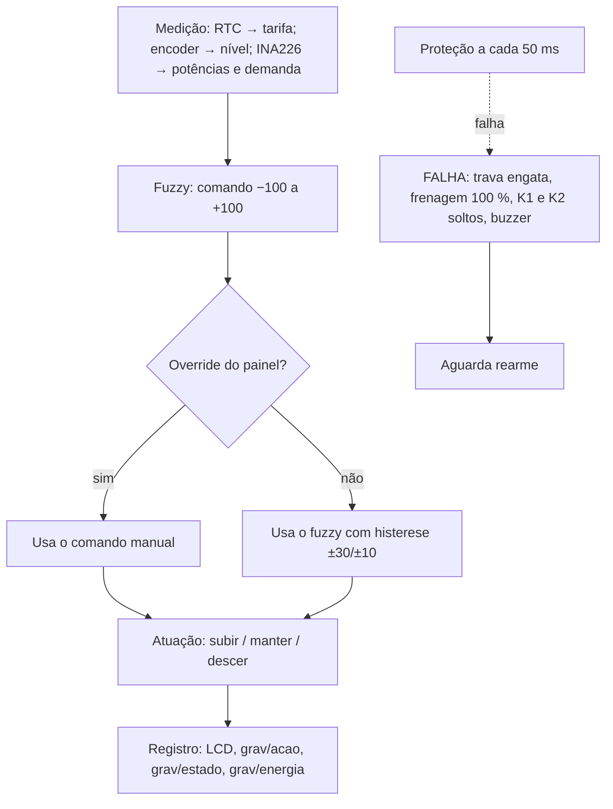

# DIAGRAMA DE BLOCOS

Regra que une os blocos: **sem o ESP32 comandando, todo relé desliga, a trava
engata e o motor fica ligado ao freio elétrico** (DEC-009).

## Integração sensores → ESP32 → atuadores

## Potência

## Fluxo do ciclo de controle

