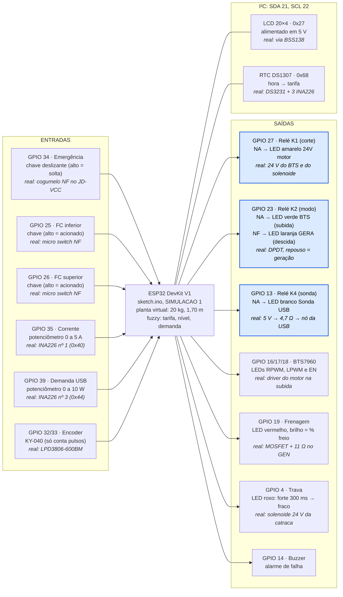
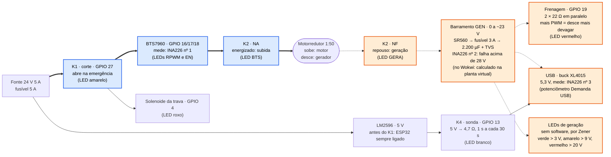

# SIMULAÇÃO NO WOKWI (visão do ARQUITETO, 2026-10-28)

Fontes: `03_SOFTWARE/firmware/wokwi/diagram.json` e `sketch.ino`
(`SIMULACAO 1`). Circuito real em `esquema_potencia.md`; pinagem em
`03_SOFTWARE/pinagem_esp32.md`.

O diagrama do Wokwi é o circuito lógico do protótipo, com a mesma pinagem do
ESP32, mas **sem nenhuma parte de potência**. Motor, gerador, BTS7960,
MOSFETs, INA226 e fonte de 24 V viraram LEDs, potenciômetros e chaves, e a
massa de 20 kg caindo 1,70 m virou uma planta virtual calculada no
`sketch.ino`.

O Wokwi valida a pinagem, a lógica dos relés K1/K2/K4 e as sequências de
operação. Ele **não** valida dimensionamento, correntes, aquecimento,
proteções nem o corte de emergência por hardware.

## 1. Ligações do Wokwi

Entradas à esquerda, saídas à direita. Os três relés são os que, no
protótipo, comutam potência de verdade.

## 2. Caminho de potência que os LEDs representam

O K2 é a chave do sistema: energizado, liga o motor ao BTS7960 para subir;
em repouso, liga o motor ao barramento gerado, que alimenta o freio, a USB e
os LEDs de geração. Como o repouso é geração com freio a 100 %, qualquer falta
de energia nos relés deixa a massa freada (DEC-009). Entre parênteses, o LED
que representa cada bloco no Wokwi.

Linha grossa (azul) = caminho da subida, K2 energizado. Linha tracejada
(laranja) = caminho da geração, K2 em repouso.

## 3. Mapa pino a pino

| Bloco | GPIO | Peça no Wokwi | O que representa no protótipo real |
|-------|------|---------------|------------------------------------|
| Alimentação | VIN, 3V3, GND | VIN (5 V do USB) alimenta LCD, RTC e bobinas dos relés; 3V3 alimenta chaves, potenciômetros, encoder e o comum dos relés | LM2596 em 5 V antes do K1 e 3,3 V do regulador do ESP32 |
| 1. Corte | 27 | Relé K1; NA acende o LED amarelo "24V motor" | K1 fecha o 24V_POT do BTS7960 e do solenoide |
| 2. Subida | 16 (RX2) | LED verde RPWM, brilho = PWM | RPWM do BTS7960, 20 kHz |
| 2. Subida | 17 (TX2) | LED azul LPWM | LPWM do BTS7960, só rearme e teste |
| 2. Subida | 18 | LED ciano EN | R_EN + L_EN com pull-down de 10 kΩ |
| 3. Modo | 23 | Relé K2: NA → LED verde "BTS", NF → LED laranja "GERA" | K2 (dois canais formando DPDT) |
| 3. Frenagem | 19 | LED vermelho, brilho = % de freio | MOSFET D4184 com 2 × 22 Ω em paralelo, 5 kHz |
| 3. Sondagem USB | 13 | Relé K4; NA acende LED branco "Sonda USB" | 5 V → K4 → 4,7 Ω → 1N5819 → nó da USB |
| 4. Trava | 4 | LED roxo, forte por 300 ms e depois fraco | Solenoide 24 V no D4184, hit-and-hold 100 % → 30 % |
| 5. Segurança | 34 | Chave "Emergência" entre 3V3 e GND | Divisor 10 k / 20 k do JD-VCC, depois do cogumelo NF |
| 5. Segurança | 25 / 26 | Chaves "FC inferior" e "FC superior" | Micro switches NF com pull-up 10 kΩ + 100 nF |
| 5. Segurança | 14 | Buzzer | Buzzer ativo |
| 6. Sensores | 21 / 22 | LCD 20×4 (0x27) e DS1307 (0x68) | LCD via BSS138, DS3231 e três INA226 |
| 6. Sensores | 35 | Potenciômetro "Corrente subida", 0 a 5 A | INA226 nº 1 (motor travado acima de 3 A) |
| 6. Sensores | 39 (VN) | Potenciômetro "Demanda USB", 0 a 10 W | INA226 nº 3 (entrada do fuzzy) |
| 6. Sensores | 32 / 33 | Encoder KY-040 | LPD3806-600BM, 25,5 pulsos por mm de massa |

Na simulação, a altura vem da planta virtual e não do KY-040: girar o encoder
só muda o contador de pulsos mostrado no Serial.

## 4. Diferenças entre o Wokwi e o circuito real

A mais importante é a emergência: no Wokwi ela é só uma entrada de software;
no protótipo ela corta as bobinas dos relés por hardware (DEC-009). Um teste
de emergência aprovado no Wokwi não prova o fail-safe.

| Ponto | No Wokwi | No protótipo real | O que fazer |
|-------|----------|-------------------|-------------|
| Emergência | Chave no GPIO 34; o firmware entra em FALHA | Cogumelo NF corta o JD-VCC: K1 abre, K2 cai para geração, K4 abre, mesmo com o ESP32 travado | Testar na bancada com o ESP32 parado |
| Polaridade dos relés | Ativos em alto (`RELE_LIGA = HIGH`) | Ativos em baixo; `digitalWrite(HIGH)` antes de `pinMode` | Conferir `SIMULACAO 0` antes de gravar |
| K2 | Um relé com NA e NF | Dois canais no mesmo GPIO 23 (DPDT) | Ligar os dois IN juntos |
| LCD e I²C | LCD em 5 V direto no SDA/SCL | Via conversor BSS138, pull-ups do módulo retirados | Não copiar a ligação direta |
| RTC | DS1307 | DS3231 sem o diodo de carga | Troca automática pela flag |
| Encoder | KY-040 em 3,3 V, por interrupção | LPD3806 em 5 V, coletor aberto, pull-up 4,7 kΩ a 3,3 V | ESP32Encoder (PCNT), ~43 mil contagens |
| Fins de curso | Chave fixa, pull-up interno | NF com pull-up externo; fio rompido = acionado | Testar fio rompido na bancada |
| LEDs e relés | LEDs sem resistor; comum dos relés no 3V3 | Relés comutam 24 V e o barramento gerado | Os LEDs são só indicadores |
| Potência | Ausente; tensão gerada calculada (253 V por m/s) | SR560, fusível 3 A, 2.200 µF, TVS, INA226 nº 2, XL4015 | Medir na primeira descida |

Os nomes de pinos do `diagram.json` (`esp:VN`, `esp:RX2`, `esp:GND.1`) foram
escritos sem abrir o simulador (INC-031).

## 5. Como ler as sequências nos LEDs

Comandos pelo Monitor Serial (115200). Cada sequência é a de
`esquema_potencia.md`.

1. **Subir (`s`):** acende o amarelo (K1); o verde "BTS" acende e o laranja
   "GERA" apaga (K2); o ciano EN acende e o verde RPWM ganha brilho em rampa
   de 1 s. Em 1,70 m tudo apaga na ordem inversa.
2. **Descer (`d`):** K1 e K2 ligam e o RPWM pisca para subir 3 mm e aliviar a
   lingueta; o roxo acende forte por 300 ms e fica fraco; o vermelho vai a
   100 %; K2 solta (laranja "GERA" acende) e o vermelho passa a variar com a
   malha PI. Mais "Demanda USB" freia mais a massa.
3. **Manter:** tudo apagado; o branco "Sonda USB" acende 1 s a cada 30 s.
4. **Falha:** deslizar "Emergência" dispara o buzzer, apaga K1, K2 e EN e leva
   o vermelho a 100 %. Para sair, voltar a chave e mandar `r`.
5. **Automático (`a`):** o fuzzy decide a cada 5 s. `h19` força o horário de
   ponta para ver a descida.

O firmware ainda não publica em MQTT, então o painel Streamlit não recebe
dados do Wokwi; por enquanto o elo é o Monitor Serial.
