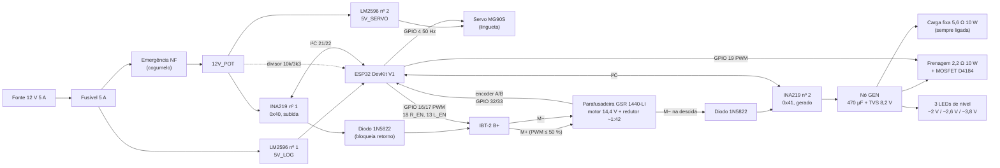
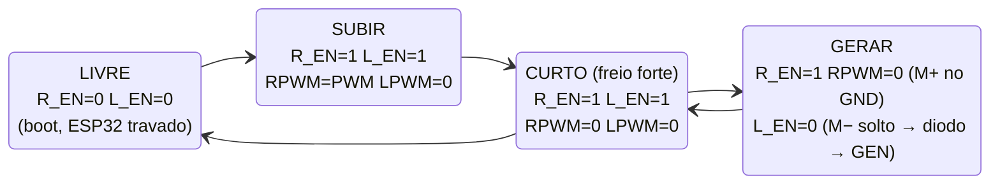

# CIRCUITO DO MVP (sem relés)

Pinagem em `../03_SOFTWARE/pinagem_mvp.md`. A ideia central: o projeto
principal usa o relé K2 para tirar o motor do BTS7960 e ligá-lo ao barramento
gerado. No MVP, as duas meias-pontes do IBT-2 têm enable separado (R_EN e
L_EN em GPIOs diferentes); desligando a meia-ponte do terminal M− ela fica em
alta impedância, e esse terminal vira a saída do gerador por um diodo. Isso
elimina K1, K2, K4 e o módulo de relés (DEC-017).

## Tensões
- Fonte 12 V **5 A** chaveada (a subida puxa ~5 A no motor, ~1,3 A da fonte;
  a folga é para a partida e para o caso de travar).
- 12V_POT: 12 V depois da emergência (IBT-2 e servo). O motor é o da
  parafusadeira GSR 1440-LI, de **14,4 V** (DEC-026), ligado direto nos
  terminais (o gatilho sai). O firmware limita o PWM a 50 % (`PWM_MAX =
  128`) para a subida nunca passar de ~0,23 m/s.
- 5V_LOG: LM2596 nº 1, antes da emergência (ESP32 continua ligado para
  avisar e receber o rearme). Durante o desenvolvimento, o ESP32 pode vir só
  da USB do notebook.
- 5V_SERVO: LM2596 nº 2, depois da emergência.
- GEN: barramento gerado, 0 a ~4 V na descida (21,8 V por m/s de massa),
  até ~6,6 V no limite de 0,30 m/s. Corrente de ~0,7 A (0,4 a 1,0 A).

## Diagrama de ligações

## Os quatro modos do IBT-2

M+ fica na meia-ponte R (RPWM, R_EN) e M− na meia-ponte L (LPWM, L_EN).
Subindo, M+ é o terminal positivo; descendo, o motor gira ao contrário e a
tensão gerada deixa **M− positivo**, por isso o diodo do gerador sai do M−.

| Modo | O que acontece | Quando |
|------|----------------|--------|
| LIVRE | Meias-pontes em alta impedância. Se a massa descer, o gerador fecha o circuito pelo diodo de corpo do lado baixo de M+ (~0,7 V a mais) e pela carga fixa: desce sozinha a ~0,19 m/s (0,11 a 0,27) | Boot (pull-down de 10 kΩ nos dois EN), ESP32 travado. A lingueta normalmente segura antes disso |
| SUBIR | PWM no M+, M− no GND. O diodo do GEN não conduz (M− ≈ 0 V) | Subida |
| GERAR | M+ no GND pelo lado baixo; M− solto, só sai pelo diodo para o GEN. A frenagem em PWM define a velocidade | Descida |
| CURTO | Os dois lados baixos ligados: o motor em curto freia a massa até quase parar (~0,006 m/s) | Parar, falha, segurar enquanto o servo mexe na lingueta |

**Por que o diodo em série no B+ do IBT-2:** acima de ~12,7 V no M−, o diodo
de corpo do lado alto de M− conduziria para o B+. Sem o diodo em série, essa
corrente chegaria ao 12V_POT, ao servo e ao divisor da emergência (que
leria "solta" mesmo com o botão apertado). Com este motor a descida gera
no máximo ~6,6 V, então isso só aconteceria girando o motor muito acima do
previsto; o diodo fica como proteção barata.

**Capacitor de 1.000 µF 25 V no B+ do IBT-2** (depois do diodo): na subida o
motor puxa pulsos de ~5 A no ritmo do PWM, acima dos 3,2 A que o INA219 nº 1
mede. O capacitor alisa os pulsos e o INA219 lê a média (~1,3 A), que é o
que a proteção de massa travada compara com `I_TRAVADO`.

## Barramento gerado (GEN)
M− → 1N5822 → INA219 nº 2 (high-side) → nó GEN com:
- 470 µF 25 V + 100 nF; TVS P6KE8.2A (com fios; ou SMBJ7.0A em SMD),
  começa a conduzir perto de 7,8 V, acima do limite de falha de 7 V.
- **Carga fixa** 5,6 Ω 10 W, sempre ligada: limita a descida a ~0,19 m/s
  (0,11 a 0,27) mesmo sem ESP32.
- **Frenagem** 2,2 Ω 10 W em série com módulo MOSFET D4184 (GPIO 19, PWM
  5 kHz), 1N5822 em antiparalelo (a corrente chega a ~1 A). Mais PWM = mais freio = descida mais lenta
  (mesma convenção do projeto principal).
- **LEDs de nível (sem software), cada um com 220 Ω em série:** verde
  sozinho (acende acima de ~2 V, 0,09 m/s); amarelo com 1 diodo 1N4148 em
  série (~2,6 V, 0,12 m/s); vermelho com 3 diodos 1N4148 em série (~3,8 V,
  0,17 m/s; a 0,18 m/s, ponto de projeto, os 3 acendem). Os limiares são
  baixos porque o motor 550 com o redutor de ~1:42 gera pouca tensão por
  velocidade (C-107).

Valores de 5,6 Ω e 2,2 Ω são o ponto de partida de C-109; o ensaio 4 e o 5
decidem os finais.

## Trava
Servo MG90S no 5V_SERVO, sinal no GPIO 4 (50 Hz). Dois ângulos: ENGATADA
(lingueta solta, a mola a encosta na catraca) e SOLTA (servo puxa o elo).
Apertar a emergência tira o 5V_SERVO: a mola engata a lingueta mesmo que o
ESP32 continue mandando "solta". Conferir no ensaio 3 que o servo sem pulso
não segura a posição (servos analógicos soltam; alguns digitais não).

## Segurança
- Emergência NF corta 12V_POT: sem motor, sem servo (lingueta engata).
- Divisor 10 kΩ / 3,3 kΩ do 12V_POT ao GPIO 34 informa a emergência
  (12 V → ~3,0 V).
- Fins de curso NF entre GPIO e GND, pull-up 10 kΩ a 3,3 V + 100 nF. Fio
  rompido = acionado.
- Pull-down de 10 kΩ em R_EN e L_EN.
- Watchdog do ESP32 ligado.
- Fusível 5 A retardado na saída da fonte.

## Sensores
| Peça | Ligação | Observação |
|------|---------|------------|
| Encoder LPD3806-600BM no eixo do tambor | VCC 5 V (5V_LOG); A/B (saída coletor aberto NPN) no GPIO 32/33 com pull-up 4,7 kΩ a **3,3 V** | O motor da parafusadeira não tem encoder. Com coletor aberto e pull-up em 3,3 V, o sinal nunca passa de 3,3 V |
| INA219 nº 1 (subida) | I²C 0x40, high-side no 12V_POT antes do diodo do B+ | Shunt original 0,1 Ω (até 3,2 A, 26 V) |
| INA219 nº 2 (gerado) | I²C 0x41 (jumper A0), high-side no GEN | Mede tensão e corrente geradas (até ~1 A: calibração padrão de 3,2 A) |

## O que fica igual ao projeto principal
Fins de curso NF, emergência cogumelo, IBT-2, MOSFET D4184, ESP32, encoder em
quadratura com ESP32Encoder, fuzzy, painel. Quem já comprou essas peças para
o projeto principal reaproveita.
