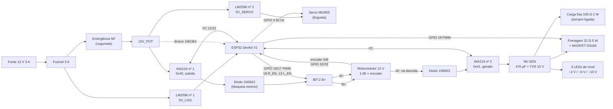
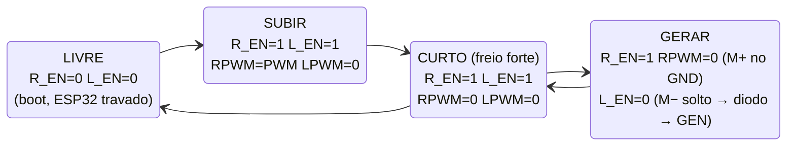

# CIRCUITO DO MVP (sem relés)

Pinagem em `../03_SOFTWARE/pinagem_mvp.md`. A ideia central: o projeto
principal usa o relé K2 para tirar o motor do BTS7960 e ligá-lo ao barramento
gerado. No MVP, as duas meias-pontes do IBT-2 têm enable separado (R_EN e
L_EN em GPIOs diferentes); desligando a meia-ponte do terminal M− ela fica em
alta impedância, e esse terminal vira a saída do gerador por um diodo. Isso
elimina K1, K2, K4 e o módulo de relés (DEC-017).

## Tensões
- Fonte 12 V 3 A chaveada.
- 12V_POT: 12 V depois da emergência (IBT-2 e servo).
- 5V_LOG: LM2596 nº 1, antes da emergência (ESP32 continua ligado para
  avisar e receber o rearme). Durante o desenvolvimento, o ESP32 pode vir só
  da USB do notebook.
- 5V_SERVO: LM2596 nº 2, depois da emergência.
- GEN: barramento gerado, 0 a ~11 V na descida (214 V por m/s de massa).

## Diagrama de ligações

## Os quatro modos do IBT-2

M+ fica na meia-ponte R (RPWM, R_EN) e M− na meia-ponte L (LPWM, L_EN).
Subindo, M+ é o terminal positivo; descendo, o motor gira ao contrário e a
tensão gerada deixa **M− positivo**, por isso o diodo do gerador sai do M−.

| Modo | O que acontece | Quando |
|------|----------------|--------|
| LIVRE | Meias-pontes em alta impedância. Se a massa descer, o gerador fecha o circuito pelo diodo de corpo do lado baixo de M+ (~0,7 V a mais) e pela carga fixa: desce sozinha a 0,04–0,06 m/s | Boot (pull-down de 10 kΩ nos dois EN), ESP32 travado. A lingueta normalmente segura antes disso |
| SUBIR | PWM no M+, M− no GND. O diodo do GEN não conduz (M− ≈ 0 V) | Subida |
| GERAR | M+ no GND pelo lado baixo; M− solto, só sai pelo diodo para o GEN. A frenagem em PWM define a velocidade | Descida |
| CURTO | Os dois lados baixos ligados: o motor em curto freia a massa até quase parar (< 0,002 m/s) | Parar, falha, segurar enquanto o servo mexe na lingueta |

**Por que o diodo em série no B+ do IBT-2:** acima de ~12,7 V no M−, o diodo
de corpo do lado alto de M− conduziria para o B+. Sem o diodo em série, essa
corrente chegaria ao 12V_POT, ao servo e ao divisor da emergência (que
leria "solta" mesmo com o botão apertado). Com o diodo, ela só carrega os
capacitores do próprio IBT-2.

## Barramento gerado (GEN)
M− → 1N5822 → INA219 nº 2 (high-side) → nó GEN com:
- 470 µF 25 V + 100 nF; TVS SMBJ15A (conduz acima de ~16,7 V).
- **Carga fixa** 100 Ω 2 W, sempre ligada: limita a descida mesmo sem ESP32.
- **Frenagem** 22 Ω 5 W em série com módulo MOSFET D4184 (GPIO 19, PWM
  5 kHz), 1N5819 em antiparalelo. Mais PWM = mais freio = descida mais lenta
  (mesma convenção do projeto principal).
- **LEDs de nível (sem software):** verde com 1 kΩ (acende acima de ~2 V);
  amarelo com Zener 4,7 V + 1 kΩ (~6,5 V); vermelho com Zener 8,2 V + 1 kΩ
  (~10 V, ponto de projeto).

Valores de 100 Ω e 22 Ω são o ponto de partida de C-109; o ensaio 4 e o 5
decidem os finais.

## Trava
Servo MG90S no 5V_SERVO, sinal no GPIO 4 (50 Hz). Dois ângulos: ENGATADA
(lingueta solta, a mola a encosta na catraca) e SOLTA (servo puxa o elo).
Apertar a emergência tira o 5V_SERVO: a mola engata a lingueta mesmo que o
ESP32 continue mandando "solta". Conferir no ensaio 3 que o servo sem pulso
não segura a posição (servos analógicos soltam; alguns digitais não).

## Segurança
- Emergência NF corta 12V_POT: sem motor, sem servo (lingueta engata).
- Divisor 10 kΩ / 3,3 kΩ do 12V_POT ao GPIO 34 informa a emergência
  (12 V → ~3,0 V).
- Fins de curso NF entre GPIO e GND, pull-up 10 kΩ a 3,3 V + 100 nF. Fio
  rompido = acionado.
- Pull-down de 10 kΩ em R_EN e L_EN.
- Watchdog do ESP32 ligado.
- Fusível 3 A retardado na saída da fonte.

## Sensores
| Peça | Ligação | Observação |
|------|---------|------------|
| Encoder Hall do motor | VCC 3,3 V; A/B no GPIO 32/33 com pull-up 4,7 kΩ a 3,3 V | Alimentado em 3,3 V para a saída não passar de 3,3 V; conferir que o modelo aceita (a maioria aceita 3,3–5 V) |
| INA219 nº 1 (subida) | I²C 0x40, high-side no 12V_POT antes do diodo do B+ | Shunt original 0,1 Ω (até 3,2 A, 26 V) |
| INA219 nº 2 (gerado) | I²C 0x41 (jumper A0), high-side no GEN | Mede tensão e corrente geradas |

## O que fica igual ao projeto principal
Fins de curso NF, emergência cogumelo, IBT-2, MOSFET D4184, ESP32, encoder em
quadratura com ESP32Encoder, fuzzy, painel. Quem já comprou essas peças para
o projeto principal reaproveita.
