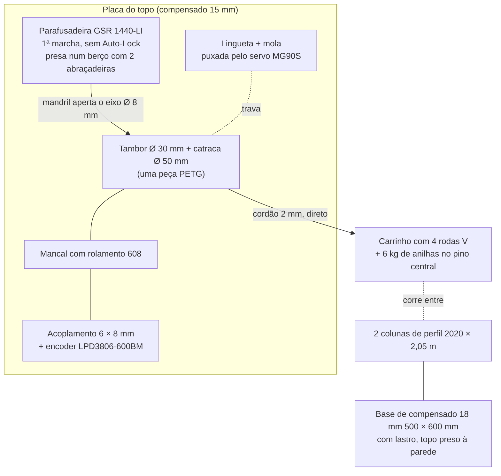

# MECÂNICA PARA FABLAB — MVP

Base: m_c = 6 kg de anilhas, h = 1,70 m, **parafusadeira Bosch GSR 1440-LI
inteira** como motor e redutor (DEC-026), sem talha (DEC-025), cálculos em
`../01_FISICA/calculos_energia.md`. Nenhuma peça pede solda, torno ou
serralheria: tudo sai de corte a laser, impressão 3D, CNC router (opcional),
serra e furadeira.

## Arranjo
Mesmo princípio do projeto principal, em escala menor: duas colunas-guia, um
carrinho que corre entre elas e a parafusadeira no topo enrolando o cordão,
que desce direto do tambor ao carrinho (sem talha, DEC-025). O mandril da
parafusadeira prende um eixo de aço de Ø 8 mm; o tambor com a catraca fica
nesse eixo, que apoia num rolamento 608 do outro lado e termina no encoder.

## Preparar a parafusadeira
1. **Tirar a bateria e o gatilho.** Abrir o corpo, desligar o gatilho
   (ele tem a eletrônica de velocidade) e soldar dois fios de 1 mm²
   direto nos terminais do motor. Esses fios vão ao IBT-2.
2. **Tirar a trava Auto-Lock.** Ela trava o mandril quando o motor não
   está sendo acionado, e com ela a massa nunca desce. Fica na saída do
   redutor, na frente: em geral são 3 roletes ou pinos de aço entre o eixo
   do mandril e um anel. Tirar o mandril (parafuso de rosca **esquerda**
   dentro dele), abrir a frente do redutor, **fotografar** e retirar os
   roletes. Não achei o desenho de peças desse modelo; o critério é o ensaio
   0 (a): sem bateria, o mandril tem de girar à mão e levar o motor junto.
   Guarde o gatilho e os roletes num saco: com eles a parafusadeira volta a
   ser parafusadeira depois do MVP.
3. **Fixar a 1ª marcha** (seletor no "1") e a embreagem na posição de
   furar (a broca no anel), para ela não patinar. Prender os dois com fita.
4. **Berço:** peça impressa ou de compensado que abraça o corpo do motor e
   o redutor, presa à placa do topo, com duas abraçadeiras metálicas. O
   mandril fica alinhado com o mancal 608.

## Peças e processo

| Peça | Especificação | Processo |
|------|---------------|----------|
| Colunas-guia | 2 × perfil de alumínio V-slot 20 × 20 × 2.050 mm | Serra; comprar barras de 3 m ou já cortadas |
| Travessas | 3 × perfil 2020 × 260 mm (topo, ~0,70 m e ~1,40 m), cantoneiras e porcas T M5 | Serra |
| Base | Compensado 18 mm, 500 × 600 mm | CNC router ou serra circular |
| Placa do topo | Compensado 15 mm, 400 × 200 mm, com o berço da parafusadeira, o mancal, o encoder e a passagem do cordão | CNC router ou laser (se cortar 15 mm) |
| Berço da parafusadeira | PETG ou compensado, abraça o corpo do motor e do redutor; 2 abraçadeiras metálicas | Impressão 3D ou laser |
| Mãos-francesas | 4 triângulos de MDF 6 mm unindo colunas e base | Laser |
| Carrinho | Compensado 15 mm, 260 × 220 mm, 4 rodas V-slot com espaçador excêntrico, pino central do diâmetro do furo das anilhas (28 mm ou 25 mm) com trava e olhal no topo para amarrar o cordão | CNC ou serra + furadeira |
| Eixo do tambor | Barra de aço Ø 8 mm × ~200 mm (cabe no mandril, que aperta de 0,8 a 10 mm) | Serra |
| Tambor + catraca | PETG 100 % de preenchimento nos dentes, Ø 28 mm no fundo do canal helicoidal (passo 2,5 mm, 60 mm úteis), catraca Ø 50 mm com 24 dentes, furo Ø 8 mm com parafuso M3 e porca embutida apertando o eixo | Impressão 3D |
| Mancal do tambor | Rolamento 608 num suporte impresso parafusado à placa do topo | Impressão 3D |
| Encoder | LPD3806-600BM (eixo Ø 6 mm) num suporte impresso, ligado ao eixo de Ø 8 mm por acoplamento flexível 6 × 8 mm | Comprado + impressão 3D |
| Lingueta | PETG, pivô em parafuso M4, mola de tração pequena puxando para a catraca; o servo puxa por um elo de arame 1 mm | Impressão 3D |
| Suportes dos fins de curso | PETG, presos no canal do perfil com porca T: a posição se ajusta deslizando | Impressão 3D |
| Caixa da eletrônica | MDF 3 mm com tampa de acrílico 3 mm | Laser |
| Cordão | Dyneema ou poliéster trançado 2 mm, ruptura ≥ 100 kg, ~3 m | Comprado |
| Massa | Anilhas totalizando 6 kg (já disponíveis) | — |
| Batente | EVA 20 mm na base, sob o carrinho | Estilete |

## Por que estas escolhas
- **Perfil 2020 em vez de metalon:** é guia e estrutura ao mesmo tempo, as
  rodas V correm direto nele, e os fins de curso deslizam no canal. Muitos
  fablabs têm sobras de impressoras 3D e CNCs.
- **Parafusadeira inteira:** o motor sozinho gira a ~17.600 rpm e precisaria
  de uma redução de ~250:1. O redutor planetário da própria parafusadeira
  (~1:42 na 1ª marcha) aguenta 30 N·m e o mandril já é o acoplamento do
  eixo. Custo: tirar a trava e o gatilho.
- **6 kg, sem talha, tambor de Ø 30 mm:** o motor de parafusadeira tem
  muito atrito interno (~1 A em vazio). Só com 6 kg no tambor de Ø 30 mm a
  massa aplica no motor ~1,7× esse atrito e desce sozinha (C-104). Com 2 kg
  não desceria. Sem talha, sai uma polia e um rolamento.
- **Encoder no eixo do tambor:** o motor da parafusadeira não tem encoder.
  O LPD3806 é o mesmo do projeto principal.
- **Servo + mola no lugar do solenoide:** o servo de 5 V não precisa de
  MOSFET nem de hit-and-hold. A falha continua segura: sem energia no servo,
  a mola encosta a lingueta e a catraca segura a massa.

## Estrutura
- Carga no topo: ~60 N com 6 kg, ~120 N num tranco, mais a parafusadeira
  (1,3 kg). Perfil 2020 de 2,05 m com
  as mãos-francesas e três travessas tem folga grande para isso; o que
  preocupa é tombar e flexionar, não quebrar.
- Tombamento: com as anilhas e a parafusadeira no alto, o centro de massa passa de 1,8 m. Base
  de 500 × 600 mm com ~10 kg de lastro **e** a travessa do topo presa à
  parede por duas cantoneiras (a torre fica encostada numa parede do
  fablab). Sem parede, usar base de 800 × 800 mm como no projeto principal.

## Folgas obrigatórias
- **~1 cm acima do fim de curso superior.** A descida começa subindo 3 mm
  para aliviar a lingueta (mesma lógica da DEC-005 do projeto principal).
- Alturas: base 18 mm + batente 20 mm + carrinho com 3 anilhas ~180 mm (olhal
  no topo do pino) na posição inferior; 1.700 mm de curso; 10 mm de folga;
  do olhal ao tambor ~120 mm. Fecha em ~2.050 mm, a altura das colunas.
- Conferir que a torre de ~2,1 m com a parafusadeira no topo passa no pé-direito e
  na porta do fablab.
- O desenho cotado sai do ARQUITETO (HANDOFF-010).

## Segurança
- Primeiros ciclos só com o carrinho, depois com uma anilha de 2 kg e corda de segurança.
- Ninguém com mão ou pé embaixo do carrinho; a área sob a torre fica livre.
- Conferir o cordão e os nós (tambor e olhal do carrinho) antes de cada sessão.
