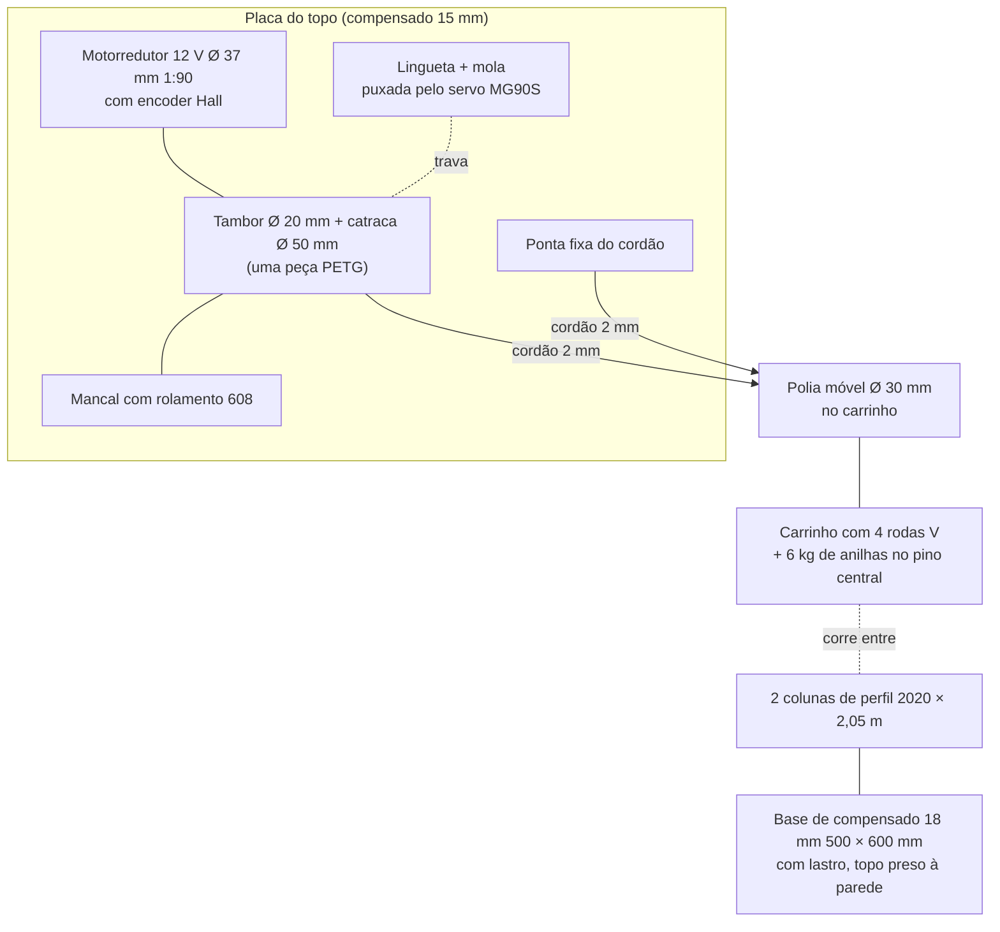

# MECÂNICA PARA FABLAB — MVP

Base: m_c = 6 kg de anilhas, h = 1,70 m (DEC-014), cálculos em
`../01_FISICA/calculos_energia.md`. Nenhuma peça pede solda, torno ou
serralheria: tudo sai de corte a laser, impressão 3D, CNC router (opcional),
serra e furadeira.

## Arranjo
Mesmo princípio do projeto principal, em escala menor: duas colunas-guia, um
carrinho que corre entre elas, talha 2:1 (ponta fixa no topo, polia móvel no
carrinho, outra ponta no tambor) e o motorredutor no topo enrolando o cordão.
A catraca é parte da mesma peça impressa do tambor.

## Peças e processo

| Peça | Especificação | Processo |
|------|---------------|----------|
| Colunas-guia | 2 × perfil de alumínio V-slot 20 × 20 × 2.050 mm | Serra; comprar barras de 3 m ou já cortadas |
| Travessas | 3 × perfil 2020 × 260 mm (topo, ~0,70 m e ~1,40 m), cantoneiras e porcas T M5 | Serra |
| Base | Compensado 18 mm, 500 × 600 mm | CNC router ou serra circular |
| Placa do topo | Compensado 15 mm, 300 × 150 mm, furos do motor, do mancal e da ponta fixa | CNC router ou laser (se cortar 15 mm) |
| Mãos-francesas | 4 triângulos de MDF 6 mm unindo colunas e base | Laser |
| Carrinho | Compensado 15 mm, 260 × 220 mm, 4 rodas V-slot com espaçador excêntrico, pino central do diâmetro do furo das anilhas (28 mm ou 25 mm) com trava | CNC ou serra + furadeira |
| Polia móvel | PETG, Ø 30 mm no fundo do canal, rolamento 608, eixo M8 | Impressão 3D |
| Tambor + catraca | PETG 100 % de preenchimento nos dentes, Ø 18 mm no fundo do canal helicoidal (passo 2,5 mm, 150 mm úteis), catraca Ø 50 mm com 24 dentes, furo D 6 mm com parafuso M3 e porca embutida, pino de aço Ø 8 mm na outra ponta | Impressão 3D |
| Mancal do tambor | Rolamento 608 num suporte impresso parafusado à placa do topo | Impressão 3D |
| Suporte do motor | Suporte em L para motor de 37 mm (vem com o motor ou impresso), 6 × M3 | Comprado ou impresso |
| Lingueta | PETG, pivô em parafuso M4, mola de tração pequena puxando para a catraca; o servo puxa por um elo de arame 1 mm | Impressão 3D |
| Suportes dos fins de curso | PETG, presos no canal do perfil com porca T: a posição se ajusta deslizando | Impressão 3D |
| Caixa da eletrônica | MDF 3 mm com tampa de acrílico 3 mm | Laser |
| Cordão | Dyneema ou poliéster trançado 2 mm, ruptura ≥ 100 kg, ~6 m | Comprado |
| Massa | Anilhas totalizando 6 kg (já disponíveis) | — |
| Batente | EVA 20 mm na base, sob o carrinho | Estilete |

## Por que estas escolhas
- **Perfil 2020 em vez de metalon:** é guia e estrutura ao mesmo tempo, as
  rodas V correm direto nele, e os fins de curso deslizam no canal. Muitos
  fablabs têm sobras de impressoras 3D e CNCs.
- **Tambor no eixo do motor com mancal do outro lado:** dispensa eixo de aço,
  mancais UCP e acoplamento. O mancal 608 tira do redutor a carga radial do
  cordão (29,4 N). Com 150 mm de tambor, ele é obrigatório.
- **Talha 2:1 mantida:** divide o torque no tambor por dois (0,294 N·m) e
  dobra a rotação no gerador, que é o que dá tensão para os LEDs. Custa uma
  polia impressa e um rolamento.
- **Servo + mola no lugar do solenoide:** o servo de 5 V não precisa de
  MOSFET nem de hit-and-hold. A falha continua segura: sem energia no servo,
  a mola encosta a lingueta e a catraca segura a massa.

## Estrutura
- Carga no topo: 59 N com 6 kg, 118 N num tranco. Perfil 2020 de 2,05 m com
  as mãos-francesas e três travessas tem folga grande para isso; o que
  preocupa é tombar e flexionar, não quebrar.
- Tombamento: com as anilhas no alto, o centro de massa passa de 1,8 m. Base
  de 500 × 600 mm com ~10 kg de lastro **e** a travessa do topo presa à
  parede por duas cantoneiras (a torre fica encostada numa parede do
  fablab). Sem parede, usar base de 800 × 800 mm como no projeto principal.

## Folgas obrigatórias
- **~1 cm acima do fim de curso superior.** A descida começa subindo 3 mm
  para aliviar a lingueta (mesma lógica da DEC-005 do projeto principal).
- Alturas: base 18 mm + batente 20 mm + carrinho com 3 anilhas de 2 kg
  ~180 mm (polia no topo do pino) na posição inferior; 1.700 mm de curso;
  10 mm de folga; da polia móvel ao topo da placa ~120 mm. Fecha em
  ~2.050 mm, a altura das colunas (perto dos 2,10 m do projeto principal).
- Conferir que a torre de ~2,1 m com o motor no topo passa no pé-direito e
  na porta do fablab.
- O desenho cotado sai do ARQUITETO (HANDOFF-010).

## Segurança
- Primeiros ciclos só com o carrinho, depois com uma anilha de 2 kg e corda de segurança.
- Ninguém com mão ou pé embaixo do carrinho; a área sob a torre fica livre.
- Conferir o cordão e o nó da ponta fixa antes de cada sessão.
