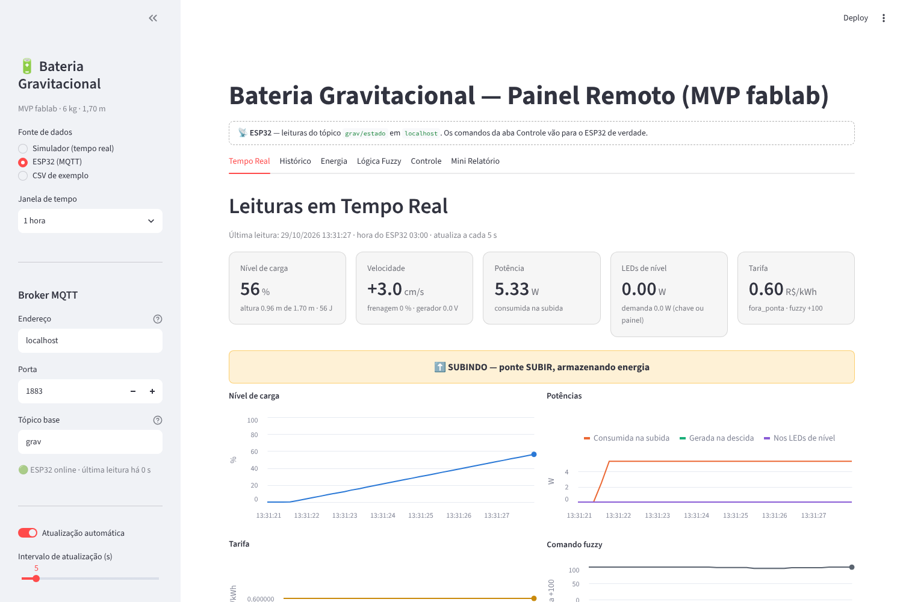

# 03 — Ligar o ESP32 ao painel

Três peças: o **Mosquitto** (broker MQTT) e o **painel Streamlit** rodando
no notebook, e o ESP32 na mesma rede Wi-Fi.

## 1. Instalar e ligar o Mosquitto

### Windows
1. Baixe o instalador 64 bits em <https://mosquitto.org/download/> e
   instale (pasta padrão `C:\Program Files\mosquitto`).
2. O Mosquitto 2 só aceita conexões do próprio computador até você dizer o
   contrário. Abra o Bloco de Notas **como administrador**, crie
   `C:\Program Files\mosquitto\grav.conf` com:
   ```
   listener 1883 0.0.0.0
   allow_anonymous true
   ```
3. Abra o **Prompt de Comando** e rode (deixe a janela aberta):
   ```
   "C:\Program Files\mosquitto\mosquitto.exe" -c "C:\Program Files\mosquitto\grav.conf" -v
   ```
   Se der “Only one usage of each socket address”, o serviço do Mosquitto já
   está rodando: pare com `net stop mosquitto` (Prompt como administrador) e
   rode o comando de novo.
4. Libere a porta no firewall (Prompt como administrador, uma vez só):
   ```
   netsh advfirewall firewall add rule name="Mosquitto 1883" dir=in action=allow protocol=TCP localport=1883
   ```
   Se o Windows perguntar se permite o Mosquitto em redes privadas, permita.

### Linux (Ubuntu/Debian)
```bash
sudo apt install mosquitto mosquitto-clients
printf 'listener 1883 0.0.0.0\nallow_anonymous true\n' | sudo tee /etc/mosquitto/conf.d/grav.conf
sudo systemctl restart mosquitto
```

### macOS
```bash
brew install mosquitto
printf 'listener 1883 0.0.0.0\nallow_anonymous true\n' > ~/grav.conf
mosquitto -c ~/grav.conf -v
```

> `allow_anonymous true` deixa qualquer aparelho **da mesma rede** publicar
> no broker. Serve para a bancada; não abra a porta 1883 para a internet.

## 2. Achar o IP do notebook
- Windows: `ipconfig` → “Endereço IPv4” do adaptador Wi-Fi (ex. `192.168.0.42`).
- Linux: `hostname -I`. macOS: `ipconfig getifaddr en0`.

Esse número vai em `MQTT_BROKER` no sketch, com `TOPICO_BASE = "grav"`.
Grave o ESP32 de novo ([01_gravar_firmware.md](01_gravar_firmware.md), passo 6).
O IP pode mudar quando o notebook reconecta no Wi-Fi; se o ESP32 parar de
conectar no dia seguinte, confira de novo.

**Rede:** o ESP32 e o notebook precisam estar na mesma rede, e ela não
pode isolar os aparelhos (redes “convidado” e de faculdade costumam
isolar). O caminho mais curto é o **roteador do celular**: notebook e ESP32
conectados nele, banda 2,4 GHz.

## 3. Conferir que o ESP32 está publicando
Em outro terminal:
```
mosquitto_sub -h localhost -t "grav/#" -v
```
(no Windows, rode de dentro de `C:\Program Files\mosquitto`.) Deve aparecer
`grav/online 1` e uma linha `grav/estado {...}` por segundo. Se não aparecer
nada, veja [04_problemas_comuns.md](04_problemas_comuns.md) antes de abrir o
painel.

## 4. Rodar o painel
Precisa do Python 3.10 ou mais novo (<https://www.python.org/downloads/>; no
Windows marque “Add python.exe to PATH”).

```bash
cd MVP_FABLAB/03_SOFTWARE/dashboard
python -m venv .venv
.venv\Scripts\activate          # Windows
# source .venv/bin/activate     # Linux e macOS
pip install -r requirements.txt
streamlit run dashboard.py
```

O navegador abre em <http://localhost:8501>. Na barra lateral:

1. **Fonte de dados → ESP32 (MQTT)**.
2. **Broker MQTT:** endereço `localhost` (o Mosquitto está no mesmo
   notebook), porta `1883`, tópico base `grav`.
3. Embaixo aparece 🟢 “ESP32 online” e o painel abre sozinho na primeira
   leitura.



*Captura feita com mensagens geradas pelo firmware num teste no computador,
não com um ESP32 de verdade.*

O painel guarda as leituras enquanto estiver aberto (até 24 h). Para salvar,
use **Histórico → Baixar CSV**.

## 5. Mandar comandos
Aba **Controle**:

| Botão | Mensagem em `grav/comando` | Igual ao Serial |
|-------|----------------------------|-----------------|
| Automático (fuzzy) | `{"acao": "auto"}` | `a` |
| Subir / Descer / Parar | `{"acao": "subir"}` … | `s` / `d` / `p` (põem em manual) |
| Rearmar | `{"acao": "rearmar"}` | `r` (só sai de `FALHA` com a emergência solta) |
| Enviar demanda | `{"demanda_w": 3.0}` | `w3` |
| Enviar hora | `{"hora": 19.0}` (−1 volta ao NTP) | `h19` / `hx` |

As **tarifas** da barra lateral vão sozinhas para `grav/tarifas` sempre que
mudam. A mensagem fica retida no broker, então o ESP32 recebe de novo
quando reinicia.

O Monitor Serial continua funcionando junto com o painel; o ESP32 imprime
cada mensagem MQTT que recebe (`mqtt grav/comando {...}`).

## Atalho: Wokwi + broker público (sem ESP32)
O ESP32 simulado do Wokwi não enxerga o Mosquitto do seu notebook, mas chega
a brokers públicos pela internet.

1. No `sketch.ino` do Wokwi: `MQTT_BROKER = "broker.hivemq.com"` e um
   `TOPICO_BASE` que ninguém mais use (ex. `grav-gabriel-7731`).
   `libraries.txt` já tem `PubSubClient`.
2. No painel: endereço `broker.hivemq.com`, porta `1883`, tópico base igual
   ao do sketch.

Só com `SIMULACAO 1`: num broker público qualquer um que adivinhe o tópico
consegue mandar comandos.
