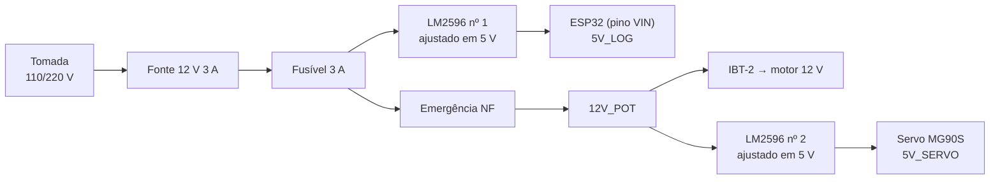

# 05 — Lista de compras da eletrônica

Preços aproximados, **não cotados** (mesma base de
`../02_ARQUITETO/bom_e_cortes.md`). "Reaproveita" = peça que também serve no
projeto principal; quem já tem não compra.

## Alimentação: como o MVP é ligado

Tudo sai de **uma fonte chaveada 12 V 3 A ligada na tomada** (110/220 V).
Não há bateria. Depois da fonte:

- O ESP32 fica **antes** da emergência: apertar o botão corta motor e servo,
  mas o ESP32 continua ligado para avisar o painel e aceitar o rearme.
- Os LEDs de nível **não** gastam da fonte: acendem com a energia que o
  próprio motor gera na descida.
- Consumo: motor ~0,6 A na subida (até ~1,5 A na partida), servo até
  ~0,3 A tirados dos 12 V, ESP32 ~0,1 A. A fonte de 3 A tem folga.
- Na bancada (parte A de [02](02_teste_bancada.md)), o ESP32 roda só com o
  USB do notebook. A fonte de 12 V só entra quando o motor entra.

**Ajuste os dois LM2596 para 5,0 V com o multímetro antes de ligar
qualquer coisa neles.** Eles costumam vir de fábrica com a saída perto da
entrada (12 V), e 12 V queima o ESP32 e o servo.

## Ordem de compra
1. **Primeiro, só o motor** (e o suporte). O ensaio 0 diz se ele desce
   sozinho com a massa (`../01_FISICA/validacao_experimental.md`). Se não
   descer, troca de motor antes de gastar com o resto (Q-012).
2. **Depois, o resto da lista.**

## Lista

### Compra 1: motor
| ☐ | Item | Especificação | Qtd | R$ |
|---|------|---------------|-----|-----|
| ☐ | Motorredutor com encoder | 12 V, Ø 37 mm, engrenagens retas 1:90 (~107 rpm), encoder Hall 11 PPR, tipo JGB37-520. **Nunca sem-fim** (não desce sozinho) | 1 | 80 |
| ☐ | Suporte do motor | Suporte em L para motor de 37 mm (às vezes vem junto) | 1 | 10 |

### Alimentação
| ☐ | Item | Especificação | Qtd | R$ |
|---|------|---------------|-----|-----|
| ☐ | Fonte chaveada | 12 V 3 A (tipo "colmeia" ou fonte de mesa com plug P4) | 1 | 40 |
| ☐ | Cabo de força | Cabo com plugue de tomada, para a fonte colmeia (a de mesa já vem com cabo) | 1 | 10 |
| ☐ | Regulador | Módulo LM2596 (buck ajustável) | 2 | 24 |
| ☐ | Fusível | 3 A retardado + porta-fusível | 1 | 8 |

### Controle e sensores
| ☐ | Item | Especificação | Qtd | R$ |
|---|------|---------------|-----|-----|
| ☐ | ESP32 | DevKit V1 (ESP32-WROOM-32), 30 pinos. Reaproveita | 1 | 45 |
| ☐ | Cabo USB **de dados** | Micro-USB ou USB-C, conforme a placa (cabo só de carga não grava) | 1 | 15 |
| ☐ | Sensor de corrente | Módulo INA219 (shunt 0,1 Ω, I²C) | 2 | 30 |
| ☐ | Fim de curso | Micro switch com rolete (usar o contato NF). Reaproveita | 2 | 10 |

### Potência: motor, gerador e trava
| ☐ | Item | Especificação | Qtd | R$ |
|---|------|---------------|-----|-----|
| ☐ | Driver de motor | Módulo BTS7960 (IBT-2), 43 A. Reaproveita | 1 | 60 |
| ☐ | MOSFET da frenagem | Módulo D4184 (ou outro módulo MOSFET acionado por 3,3 V). Reaproveita | 1 | 12 |
| ☐ | Servo | MG90S (engrenagem metálica) | 1 | 25 |
| ☐ | Resistor de frenagem | 22 Ω 5 W, cerâmico (de fio) | 1 | 4 |
| ☐ | Carga fixa | 100 Ω 2 W, cerâmico | 1 | 4 |

### Segurança e interface
| ☐ | Item | Especificação | Qtd | R$ |
|---|------|---------------|-----|-----|
| ☐ | Botão de emergência | Cogumelo 22 mm com trava, contato **NF**. Reaproveita | 1 | 25 |
| ☐ | Chave de demanda | Chave alavanca liga/desliga (1 polo) | 1 | 5 |

### Semicondutores e passivos
| ☐ | Item | Para quê | Qtd | R$ |
|---|------|----------|-----|-----|
| ☐ | Diodo Schottky 1N5822 (3 A) | Saída do gerador (M− → GEN) e série no B+ do IBT-2 | 2 | 4 |
| ☐ | Diodo Schottky 1N5819 (1 A) | Antiparalelo no resistor de frenagem | 1 | 1 |
| ☐ | Diodo Zener 4,7 V ½ W | LED amarelo (acende em ~6,5 V) | 1 | 1 |
| ☐ | Diodo Zener 8,2 V ½ W | LED vermelho (acende em ~10 V) | 1 | 1 |
| ☐ | TVS SMBJ15A | Proteção do barramento gerado. Versão com fios, mais fácil de soldar: P6KE18A | 1 | 3 |
| ☐ | LED 5 mm | Verde, amarelo e vermelho (nível de geração) | 3 | 2 |
| ☐ | Capacitor eletrolítico 470 µF 25 V | Barramento gerado | 1 | 2 |
| ☐ | Capacitor cerâmico 100 nF | Barramento gerado e fins de curso (1 de sobra) | 4 | 1 |
| ☐ | Resistor 1 kΩ ¼ W | Série dos 3 LEDs | 3 | 1 |
| ☐ | Resistor 10 kΩ ¼ W | Pull-down de R_EN e L_EN (2), pull-up dos fins de curso (2), divisor da emergência (1) | 5 | 1 |
| ☐ | Resistor 3,3 kΩ ¼ W | Divisor da emergência (12 V → 3,0 V no GPIO 34) | 1 | 1 |
| ☐ | Resistor 4,7 kΩ ¼ W | Pull-up do encoder (A e B) | 2 | 1 |

Kits de resistores e de capacitores sortidos costumam sair mais baratos que
peças avulsas, e muitos fablabs têm.

### Montagem
| ☐ | Item | Especificação | Qtd | R$ |
|---|------|---------------|-----|-----|
| ☐ | Placa perfurada | 7 × 9 cm ou maior | 1 | 8 |
| ☐ | Bornes | Borne KF301 de 2 e 3 vias, para os fios de potência | ~10 | 10 |
| ☐ | Fio de potência | 1 mm² (18 AWG), vermelho e preto, ~3 m de cada | — | 12 |
| ☐ | Fio de sinal | 0,2 mm² (24 AWG) ou cabo flat; ~6 m até os fins de curso no alto da torre | — | 8 |
| ☐ | Jumpers e protoboard | Macho-fêmea e macho-macho; protoboard para a bancada | — | 15 |
| ☐ | Barra de pinos fêmea | Para o ESP32 não ficar soldado na placa | 2 | 3 |

**Total ≈ R$ 480** com tudo comprado; **≈ R$ 330** reaproveitando ESP32,
IBT-2, MOSFET, fins de curso e emergência do projeto principal.

## Ferramentas que precisam existir no fablab
Multímetro (obrigatório, para ajustar os LM2596), ferro de solda e estanho,
alicate de corte e desencapador, chaves de fenda pequenas.

## Onde cada peça liga
- Circuito completo: `../02_ARQUITETO/circuito.md`
- Pinos do ESP32: `../03_SOFTWARE/pinagem_mvp.md`
- Mecânica (perfil, chapas, filamento, cordão): `../02_ARQUITETO/bom_e_cortes.md`
