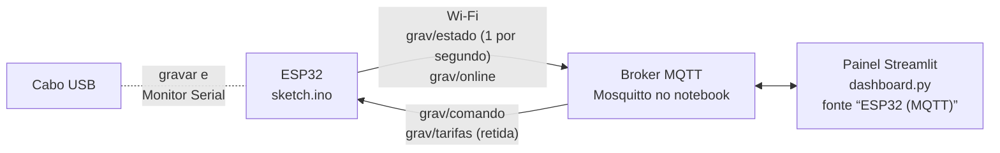

# DIY — do código ao painel, passo a passo

Guia prático para gravar o firmware do MVP no ESP32 e ver os dados no painel
Streamlit. Sim, o MVP continua com o **ESP32 DevKit V1** (ESP32-WROOM-32),
o mesmo do projeto principal.

| Arquivo | O que tem | Tempo |
|---------|-----------|-------|
| [01_gravar_firmware.md](01_gravar_firmware.md) | Arduino IDE, placa ESP32, bibliotecas, gravar e abrir o Monitor Serial | ~30 min na primeira vez |
| [02_teste_bancada.md](02_teste_bancada.md) | ESP32 sozinho com a planta virtual (4 jumpers) e depois o protótipo real, peça por peça | 15 min + ensaios |
| [03_painel_mqtt.md](03_painel_mqtt.md) | Broker Mosquitto no notebook, configurar o ESP32 e abrir o painel com a fonte “ESP32 (MQTT)” | ~20 min |
| [04_problemas_comuns.md](04_problemas_comuns.md) | O que fazer quando não grava, não conecta ou não aparece nada | consulta |

## Como as partes conversam

O ESP32 não fala direto com o painel: os dois se conectam ao **broker**, um
programa pequeno (Mosquitto) que repassa as mensagens. O broker e o painel
podem rodar no mesmo notebook.

## Ordem recomendada
1. **Gravar o firmware com `SIMULACAO 1`** num ESP32 solto, sem nada
   ligado além de 4 jumpers. O ESP32 roda a mesma planta virtual do Wokwi
   (massa de 6 kg, gerador, encoder) e você vê o ciclo inteiro no Monitor
   Serial (01 e 02, parte A).
2. **Ligar o painel** a esse ESP32 pelo Mosquitto (03). Os comandos do
   painel (subir, descer, parar, demanda, hora) já mexem na planta virtual.
   Isso prova Wi-Fi, broker e painel antes de montar qualquer peça.
3. **Montar o protótipo e trocar para `SIMULACAO 0`** (02, parte B),
   seguindo os ensaios de `../01_FISICA/validacao_experimental.md`. O
   painel não muda.

> ⚠️ **Segurança:** com a massa real pendurada, use só o Mosquitto da sua
> rede local. Num broker público (como o do Wokwi) qualquer pessoa que
> souber o tópico consegue mandar “descer”. Broker público só com
> `SIMULACAO 1`.

## Situação
O firmware e o painel foram testados fora do hardware em 2026-10-29: o
firmware compilado no computador com Wi-Fi, MQTT, INA219 e encoder
simulados, e o painel contra um broker MQTT local com mensagens geradas pelo
firmware. **Ainda não rodou num ESP32 de verdade nem dentro do Wokwi.** Se algo
destes passos não bater com o que você vê, anote em
`../00_MASTER/HANDOFF.md`.
